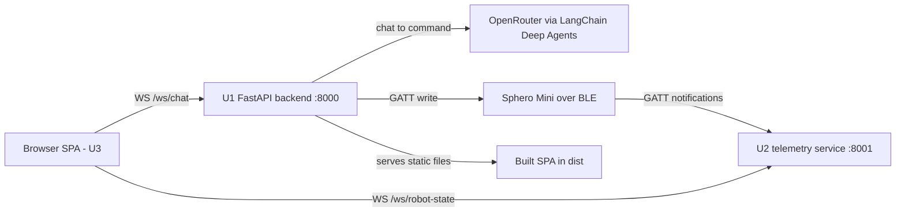
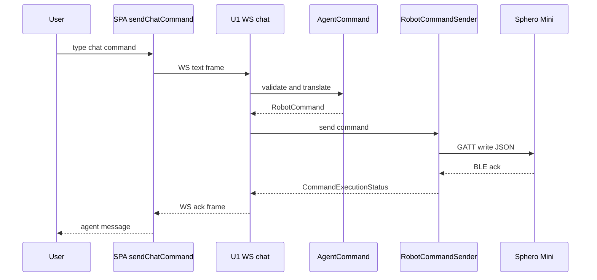
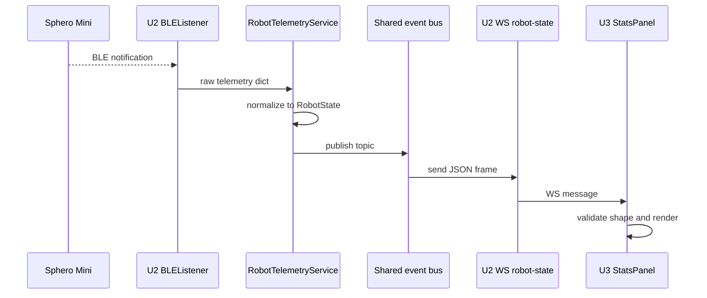

# Architecture — sphero

## Architecture Analysis

### System Overview

Three separately runnable units joined by two WebSockets and BLE. U1 (FastAPI, port 8000) owns chat validation, LLM translation and BLE control; U2 (Python service, port 8001 alongside U1) owns BLE telemetry reception and event publication; U3 is a React SPA (Vite dev server on 5173) that consumes both streams. The built SPA is served as static files by U1. Code-level detail is in `code-structure.md`; ownership is in `component-inventory.md`.

### Architectural Style

Hybrid: monolithic-per-unit processes with injected ports-and-adapters boundaries. Evidence: `BleClient`, `ModelClient`, `AgentTranslator` and `StatusCallback` protocols keep BLE/LLM/network dependencies out of the core (`backend/app/{robot_command,agent_command,chat_input,main}.py`); U2 wires a single in-process bus into both its publisher and FastAPI app (`u2_telemetry/__main__.py:63-77`); U3 keeps transport in `services/api.ts` and a single hook (`useRobotStateConnection.ts`).

### Component Relationships

Text fallback: the browser opens `/ws/chat` to U1 and `/ws/robot-state` to U2. U1 translates chat through OpenRouter and writes commands to the Sphero over BLE; the Sphero emits BLE notifications to U2; U2 broadcasts them to the browser. U1 also serves the built SPA from `dist/`.

### Data Flow

1. Chat text → `ChatInput.validate` (UTF-8, length, intent pattern) → `AgentCommand.translate` → validated `RobotCommand`.
2. `RobotCommandSender.send` encodes compact JSON, writes to the BLE control characteristic, and reports `CommandExecutionStatus` through Contract 1.
3. BLE telemetry JSON → `BLEListener._parse_telemetry` → `RobotStateNormalizer` (placeholders for missing fields) → `EventPublisher` queue → shared `RobotStateEventBus` → `/ws/robot-state` subscribers.
4. U3 validates each frame's shape, formats display values, and increments the event counter.

### Key Design Decisions

- **Lazy heavy imports**: `bleak`, `langchain-openai` and `deepagents` are imported on first use so importing the backend needs no robot, key or network (`backend/app/{agent_command,robot_command}.py`).
- **Fire-and-forget telemetry**: Contract 2 does not retry or back-pressure the publisher; dead subscribers are dropped (`u2_telemetry/event_bus.py`, `event_publisher.py`).
- **Safety stop on error**: agent/BLE/unexpected failures issue a best-effort BLE stop; validation failures do not (FR3), and a client socket close does not (`backend/app/main.py:136-153`).
- **Testability by injection**: all hardware and model boundaries are injectable, so suites run offline (see `code-quality-assessment.md`).

### Improvement Opportunities

- Reconcile the three BLE UUID sets (U1 control defaults, README vendor service, U2 telemetry characteristic) before claiming true end-to-end hardware behavior.
- Wire Contract 1 to a real consumer: U1 currently uses a documented no-op callback.
- Declare `uvicorn` in the Python runtime manifest; both entrypoints launch it.
- Unify the README's verification guidance with the two CI pytest commands.

## Interaction Diagrams

### Chat command to robot

Text fallback: a typed command travels from the SPA over `/ws/chat` to U1, through validation and LLM translation, then as a JSON BLE write to the robot; the BLE ack becomes a `CommandExecutionStatus` and an ack frame back to the chat window.

### Telemetry to stats panel

Text fallback: a BLE notification is parsed and normalized by U2, published on `robot.state.changed` through the single shared bus, delivered over `/ws/robot-state`, validated and rendered by U3's stats panel.
