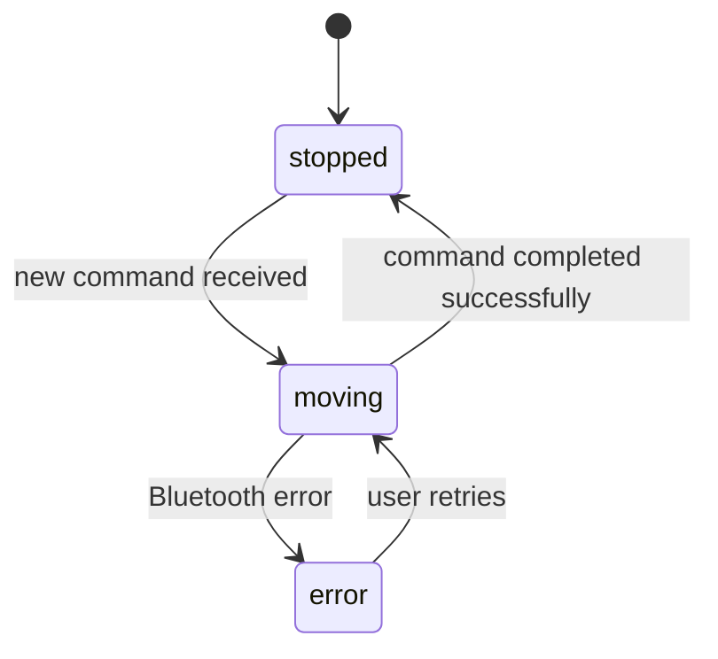

# Functional Specification — u1-chat-command-core

Grounded in stories [stories], requirements [requirements], unit-of-work [unit-of-work], components [components], and contract-summary [contract-summary].

## Workflows

### Workflow US1.1 — Chat-driven Robot Movement

**Steps:**
1. User types a chat message (e.g., "roll forward") into the message input field.
2. User presses Send (or Enter key).
3. ChatInput validates the message: non-empty, not whitespace-only, valid UTF-8, matches a known command pattern (BR1.1).
4. If validation fails, ChatInput shows a rephrase request in the chat UI (BR1.3).
5. If validation passes, ChatInput forwards the message to AgentCommand via sync function call.
6. AgentCommand translates the free-form chat into a robot command using LangChain Deep Agents + OpenRouter (BR1.2).
7. AgentCommand validates the command against the allowed vocabulary (forward/back/left/right/stop, setSpeed, setColor).
8. AgentCommand passes the validated command to RobotCommand via sync function call.
9. RobotCommand translates the command into Bluetooth LE commands and sends to the Sphero Mini.
10. RobotCommand reports execution status (moving/stopped/error) to RobotTelemetry (U2) via sync callback (BR1.4). If U2's callback is unavailable, U1 retries once with backoff; if still unavailable, U1 logs and continues.
11. Robot begins moving as commanded.

**Success outcome:** Robot moves as instructed; chat UI shows command acceptance and any errors.

**Error paths:**
- Agent uncertainty → robot stops, error shown in chat UI, user asked to rephrase (BR1.3)
- Backend error → robot stops, error shown in chat UI (BR1.3)
- Bluetooth permission denied → error shown in chat UI, robot does not move (US1.5 AC1.5.3)
- Robot disconnects mid-operation → error shown in chat UI, movement stops (US1.5 AC1.5.4)
- U2 callback unavailable → U1 retries once with backoff, then logs and continues (BR1.4)

**Note on boundaries:** RobotTelemetry (receiving telemetry from the Sphero Mini and publishing RobotState events) belongs to U2, not U1. U1's responsibility ends at reporting command execution status to U2's callback. U2 handles telemetry reception and event publishing; U3 handles stats UI rendering (see Bolt 2 and Bolt 3 in the Bolt plan).

### Workflow US1.2 — Speed Control

**Steps:**
1. User types "set speed low/medium/high" into the chat input.
2. ChatInput validates and forwards to AgentCommand.
3. AgentCommand emits RobotCommand with command=setSpeed and the speed value (BR1.2).
4. RobotCommand sends the speed command to the Sphero Mini over Bluetooth LE.
5. Subsequent movement commands use the set speed.

**Success outcome:** Robot moves at the requested speed.

## State Machine — RobotCommand

| Current State | Event | Guard Condition | Next State | Actions |
|--------------|-------|-----------------|------------|---------|
| moving | command executed | command completed successfully | stopped | Report status to RobotTelemetry |
| moving | Bluetooth error received | command failed | error | Report error status, show in chat UI |
| stopped | new command received | new command valid | moving | Send via Bluetooth LE |
| error | user retries | command re-submitted | moving | Re-attempt execution |

### State Machine Diagram (derived from rules.md)



### Entity-Relationship Diagram (derived from entities.md)

```mermaid
erDiagram
    ChatMessage ||--o{ RobotCommand : translates to (1:0..1)

    ChatMessage {
        string messageId PK
        string text
        datetime timestamp
        string direction
        string sender
        string messageType
        string language
    }
    RobotCommand {
        string commandId PK
        string command
        string speed
        string color
        datetime timestamp
        string status
        string source
        int retryCount
    }


## Assumptions & Open Questions

None.
