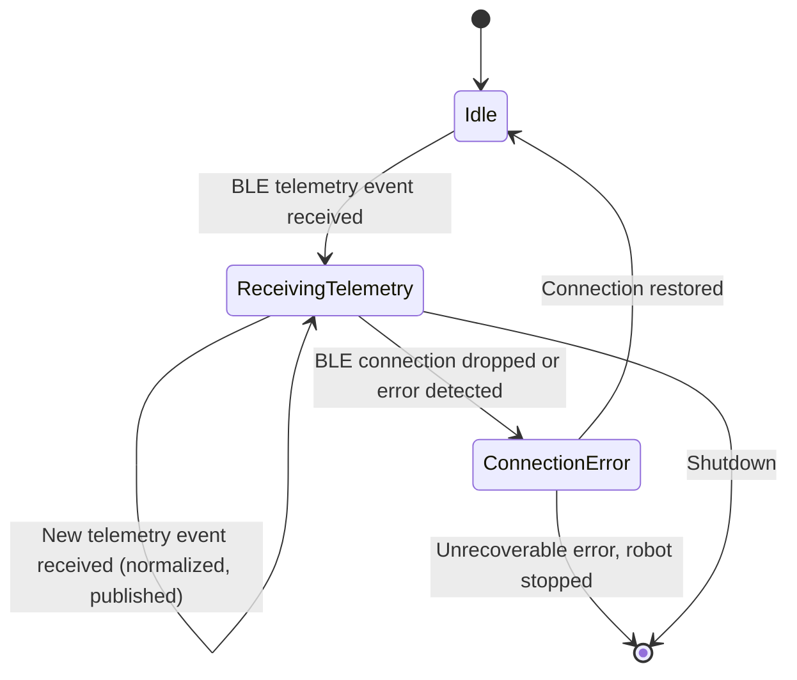
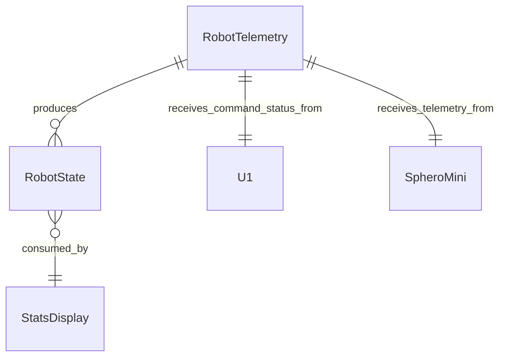

# Functional Specification — u2-telemetry

Grounded in unit-of-work [unit-of-work], unit-of-work-story-map [unit-of-work-story-map], stories [stories], requirements [requirements], components [components], contract-summary [contract-summary], entities [entities], rules [rules], and functional-design questions [functional-design-queries].

## Stories Implemented

US1.4 — Stats panel observability (telemetry reception part, AC1.4.1–AC1.4.2)

## Workflows

### Workflow US1.4.1 — Robot Telemetry Reception and Publishing

**Steps:**
1. The Sphero Mini sends raw telemetry (direction, orientation, color, position) over Bluetooth LE.
2. U2 RobotTelemetry receives the BLE telemetry event.
3. U2 normalizes the raw telemetry into a RobotState entity (BR1.4.1), using lenient normalization: missing fields are filled with dashes/null placeholders.
4. U2 assigns a backend-generated ISO-8601 timestamp to the RobotState (BR1.4.5).
5. U2 publishes a RobotStateChanged event on the `robot.state.changed` topic per Contract 2 (BR1.4.2).
6. U3 StatsDisplay receives the event and updates the stats panel UI.
7. If the BLE telemetry connection drops, U2 reports the error to U1 for chat UI display and the robot stops (BR1.4.3).
8. U2 receives CommandExecutionStatus from U1 via sync callback per Contract 1 (BR1.4.4).

### Workflow US1.4.2 — Connection Error Handling

**Steps:**
1. Bluetooth LE telemetry connection error or disconnection is detected.
2. U2 signals the error to U1 (which owns the chat UI and robot stop per FR4); U1 displays the error in the chat UI and stops the robot (FR4 / US1.5 AC1.5.4).
3. U2 attempts reconnection in the background; telemetry resumes when the connection is restored.

## State Machine



## Entity Relationship Diagram (derived from entities.md)



## Rules Summary (derived from rules.md)

| Rule ID | Category | Statement (abridged) |
|---------|----------|----------------------|
| BR1.4.1 | validation | Normalize BLE telemetry into RobotState; lenient handling of missing fields |
| BR1.4.2 | policy | Publish RobotStateChanged event on robot.state.changed topic |
| BR1.4.3 | constraint | On BLE error/disconnect: stop robot, report error to chat UI via U1 |
| BR1.4.4 | policy | Receive CommandExecutionStatus from U1 via sync callback (Contract 1) |
| BR1.4.5 | constraint | Use backend-generated ISO-8601 timestamp for each RobotState |

## Data Flow

```
Sphero Mini (BLE telemetry)
       │
       ▼
  U2 RobotTelemetry (receive + normalize)
       │
       ├─► RobotState entity (backend timestamp, lenient normalization)
       │
       ▼
  Publish RobotStateChanged event (Contract 2, robot.state.changed)
       │
       ▼
  U3 StatsDisplay (update stats panel UI)
       │
  U1 CommandExecutionStatus sync callback (Contract 1)
       │
       ▼
  Chat UI (error display, robot stop on disconnect)
```

## Assumptions & Open Questions

- U2 shares the same BLE connection as U1's command sending (Q6 answer: shared BLE client, multiplexed).
- U2 uses lenient normalization for partial telemetry (Q3 answer: accept partial telemetry, fill missing fields).
- U2 uses backend-generated timestamps (Q7 answer).
- Contract 2 uses fire-and-forget event delivery (no retry; next event overwrites).
- U2 depends on U1's CommandExecutionStatus sync callback (Contract 1).