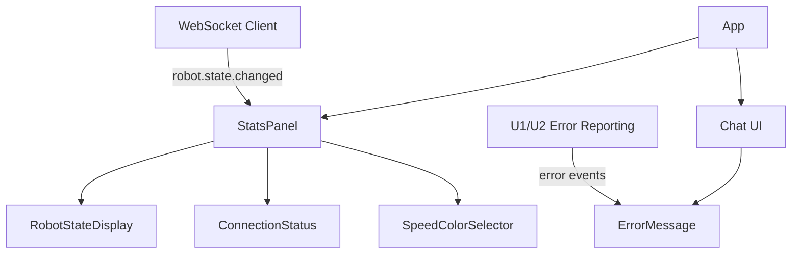

# Frontend Components — u3-stats-ui

Grounded in unit-of-work [unit-of-work], unit-of-work-story-map [unit-of-work-story-map], stories [stories], requirements [requirements], domain-design [components], contract-summary [contract-summary], and functional-design questions [functional-design-questions].

## Component Hierarchy

## Component Specifications

### StatsPanel

| Attribute | Value |
|-----------|-------|
| Purpose | Renders the robot's current state and connection status on the stats panel |
| Props | robotState: RobotState, connectionStatus: string, onSendChatCommand: (command: string) => void |
| State | None (pure presentational) |
| Renders | RobotStateDisplay, ConnectionStatus, SpeedColorSelector |
| Interactions | Receives RobotStateChanged events via WebSocket; passes values to child components; forwards onSendChatCommand to SpeedColorSelector for chat commands to U1 |

### RobotStateDisplay

| Attribute | Value |
|-----------|-------|
| Purpose | Displays direction, orientation, color, position, and timestamp |
| Props | direction: string, orientation: number, color: string, position: string, timestamp: string |
| State | None |
| Renders | Direction text, orientation degrees, color swatch, position coordinates, last-update timestamp |
| Interactions | Receives values from StatsPanel; missing fields shown as dashes (BR1.5.3) |

### ConnectionStatus

| Attribute | Value |
|-----------|-------|
| Purpose | Shows BLE connection state indicator |
| Props | status: 'connected' \| 'disconnected' \| 'pairing' \| 'error' |
| State | None |
| Renders | Status indicator (dot + label) with color coding |
| Interactions | Receives status updates from StatsPanel |

### SpeedColorSelector

| Attribute | Value |
|-----------|-------|
| Purpose | Provides inline speed and color selector buttons |
| Props | onSendChatCommand: (command: string) => void |
| State | None |
| Renders | Speed buttons (low/medium/high), color buttons (red/blue/green) |
| Interactions | On button click, calls onSendChatCommand("set speed <level>") or onSendChatCommand("set color <color>"); StatsPanel forwards the callback through the ChatUI chat input handler to U1 via the existing chat path (BR1.5.5, Q4: A) |

### ErrorMessage

| Attribute | Value |
|-----------|-------|
| Purpose | Displays error messages in the chat UI |
| Props | errorType: string, message: string, timestamp: string |
| State | None |
| Renders | Error banner or chat message with error type and message |
| Interactions | Receives error reports from U1/U2; displayed once, not persisted (ER4) |

## Interaction Flows

### Telemetry Display Flow

1. U2 publishes RobotStateChanged on `robot.state.changed` (Contract 2, fire-and-forget).
2. WebSocket client receives the event on `/ws/robot-state`.
3. StatsPanel updates robotState state.
4. RobotStateDisplay renders direction, orientation, color, position, timestamp (missing fields as dashes).
5. ConnectionStatus renders connection status (connected/disconnected/pairing/error).

### Error Display Flow

1. U1 or U2 encounters an error (unrecognized message, backend error, Bluetooth error, disconnect).
2. Error report sent to StatsDisplay.
3. ErrorMessage renders error type, message, timestamp in the chat UI.
4. User sees the error and can rephrase (if unrecognized message).

### Speed/Color Selection Flow

1. User clicks speed button (low/medium/high) or color button (red/blue/green).
2. SpeedColorSelector calls its onSendChatCommand callback with "set speed <level>" or "set color <color>".
3. StatsPanel forwards the callback through the ChatUI chat input handler (explicit callback path: SpeedColorSelector → StatsPanel → ChatUI).
4. Chat input forwards the message to U1 for translation into robot commands (BR1.5.5).

## API Integration Points

| Point | Direction | Protocol | Purpose |
|-------|-----------|----------|---------|
| WebSocket `/ws/robot-state` | Inbound (U2 → U3) | WebSocket | Receive RobotStateChanged events (Contract 2) |
| Chat input to U1 | Outbound (U3 → U1) | Chat message | Send speed/color commands (BR1.5.5) |
| SpeedColorSelector → ChatUI callback | Outbound (U3 internal) | Callback prop | onSendChatCommand from SpeedColorSelector to ChatUI chat input (BR1.5.5) |

## Assumptions & Open Questions

None.
