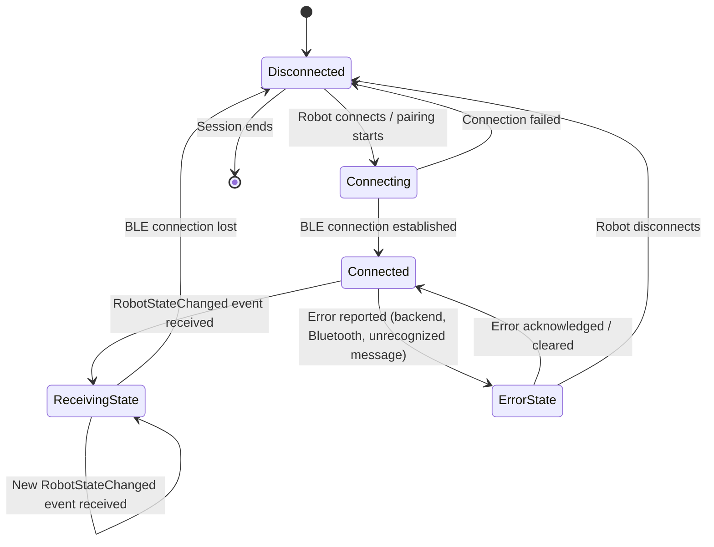
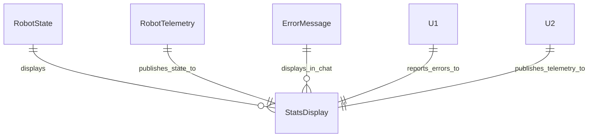

# Functional Specification — u3-stats-ui

Grounded in unit-of-work [unit-of-work], unit-of-work-story-map [unit-of-work-story-map], stories [US1.4, US1.5], requirements [requirements], domain-design [components], contract-summary [contract-summary], and functional-design questions [functional-design-questions].

## Stories Implemented

- **US1.4** — Stats panel observability (AC1.4.1–AC1.4.2)
- **US1.5** — Error handling and rephrase (AC1.5.1–AC1.5.4 partial — error display)

## Workflows

### Workflow US1.4.1 — Robot State Display and Stats Panel Update

**Steps:**
1. U2 RobotTelemetry publishes a RobotStateChanged event on the `robot.state.changed` topic per Contract 2 (fire-and-forget, WebSocket).
2. U3 StatsDisplay receives the event via WebSocket client subscribed to U2's `/ws/robot-state` endpoint (Q2: A).
3. StatsDisplay updates the stats panel UI with direction, orientation, color, position, and timestamp from the RobotState payload (BR1.5.1).
4. Missing fields are rendered as dashes (BR1.5.3, partial telemetry tolerance).
5. Connection status (connected, disconnected, pairing, error) is shown on the stats panel (BR1.5.2).

### Workflow US1.4.2 — Connection Status Display

**Steps:**
1. U2 RobotTelemetry publishes the connection status as part of the RobotStateChanged event on the `robot.state.changed` topic per Contract 2 (fire-and-forget, WebSocket).
2. U3 StatsDisplay receives the event via WebSocket client subscribed to U2's `/ws/robot-state` endpoint.
3. StatsDisplay shows the connection status indicator on the stats panel (BR1.5.2).
4. When no robot is connected, StatsDisplay shows "disconnected" status (AC1.4.2).

### Workflow US1.5.2 — Error Display in Chat UI

**Steps:**
1. U1 or U2 encounters an error (unrecognized message, backend error, Bluetooth error, disconnect).
2. U3 StatsDisplay receives the error report.
3. StatsDisplay shows an ErrorMessage component in the chat UI with error type, message, and timestamp (BR1.5.4).
4. If the robot disconnects mid-operation, StatsDisplay stops movement display and shows the error (AC1.5.4).

### Workflow US1.2/US1.3 — Speed and Color Selection

**Steps:**
1. User clicks a speed selector button (low/medium/high) or color selector button (red/blue/green).
2. SpeedColorSelector calls its onSendChatCommand callback ("set speed <level>" or "set color <color>"); StatsPanel forwards it through the ChatUI chat input path to U1 (BR1.5.5, Q4: A).
3. U1 translates the chat command into robot commands via Deep Agents + OpenRouter.

## State Machine



## Entity Relationship Diagram (derived from entities.md)



## Rules Summary (derived from rules.md)

| Rule ID | Category | Statement (abridged) |
|---------|----------|----------------------|
| BR1.5.1 | policy | Render robot state on stats panel, updated on every RobotStateChanged event |
| BR1.5.2 | constraint | Show BLE connection status on the stats panel |
| BR1.5.3 | validation | Render missing RobotState fields as dashes |
| BR1.5.4 | constraint | Display error messages in the chat UI |
| BR1.5.5 | policy | Inline speed/color buttons send chat commands to U1 |

## Data Flow

```
U2 RobotTelemetry (publish RobotStateChanged)
        │
        ▼
  WebSocket /ws/robot-state (Contract 2)
        │
        ▼
U3 StatsDisplay (receive + render)
        │
        ├─► Stats Panel (direction, orientation, color, position, timestamp)
        │
        ├─► Connection Status Indicator (connected/disconnected/pairing/error)
        │
        ├─► ErrorMessage Component (error type, message, timestamp)
        │
        └─► SpeedColorSelector (send set speed/color chat to U1)

U1/U2 Error Reporting ──► ErrorMessage in chat UI
U1 Command Path ◄────── SpeedColorSelector (chat commands)
```

## Assumptions & Open Questions

None.
