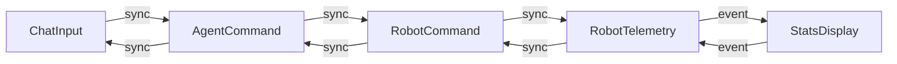

# Component Catalogue — Sphero Mini Chat Control

Grounded in requirements [requirements], user stories [stories], and team practices [team-practices].

## Part A — Machine-Readable Component Catalogue

```yaml
components:
  - name: ChatInput
    summary: >
      Accepts chat messages from the user through the web chat window and forwards
      them to the AgentCommand component for translation into robot commands.
    behaviour: >
      Receives user chat text via the chat UI input field, validates that the
      message is non-empty, and passes it synchronously to AgentCommand. Owns the
      ChatMessage entity. Displays agent responses and errors back to the user.
    responsibilities:
      - Own the ChatMessage entity lifecycle
      - Validate non-empty chat input before forwarding
      - Forward chat text to AgentCommand (sync function call)
      - Render agent responses and errors in the chat window
    depends_on:
      - component: AgentCommand
        interaction: forwards chat text for translation
        style: sync
    dependents: []
    external_dependencies: []
    entities:
      - name: ChatMessage
        identifier: messageId
        attributes: [text, timestamp, direction]
        references: []

  - name: AgentCommand
    summary: >
      Translates free-form chat messages into robot commands (movement, speed,
      LED color) using LangChain Deep Agents backed by an OpenRouter model.
    behaviour: >
      Receives chat text from ChatInput, invokes the LangChain Deep Agent with
      the OpenRouter model to determine the robot command, validates the command
      against the allowed vocabulary, and passes it synchronously to RobotCommand.
      Handles unclear/unrecognized messages by requesting rephrase via ChatInput.
    responsibilities:
      - Translate chat text into robot commands using Deep Agents + OpenRouter
      - Validate commands against the allowed vocabulary (forward/back/left/right/stop, speed, color)
      - Request rephrase from ChatInput for unclear/unrecognized messages
      - Own command validation logic and agent configuration
    depends_on:
      - component: ChatInput
        interaction: receives chat text
        style: sync
      - component: RobotCommand
        interaction: passes validated robot command
        style: sync
    dependents:
      - component: ChatInput
        interaction: sends agent responses and rephrase requests
        style: sync
    external_dependencies:
      - name: OpenRouter API
        kind: third-party-api
        purpose: hosts the LLM model used by LangChain Deep Agents for chat-to-command translation
    entities:
      - name: RobotCommand
        identifier: commandId
        attributes: [command, speed, color, timestamp]
        references: []

  - name: RobotCommand
    summary: >
      Sends validated robot commands to the Sphero Mini over Bluetooth LE and
      reports command execution status back to the system.
    behaviour: >
      Receives robot commands from AgentCommand, translates them into Bluetooth
      LE commands for the Sphero Mini, sends them over the Bluetooth connection,
      and reports execution status (moving, stopped, error) to RobotTelemetry.
    responsibilities:
      - Translate robot commands to Bluetooth LE commands
      - Send commands to the Sphero Mini over Bluetooth LE
      - Report execution status to RobotTelemetry
      - Handle Bluetooth connection errors and disconnections
    depends_on:
      - component: AgentCommand
        interaction: receives validated robot command
        style: sync
      - component: RobotTelemetry
        interaction: reports command execution status
        style: sync
    dependents:
      - component: AgentCommand
        interaction: receives validated robot commands
        style: sync
    external_dependencies:
      - name: Sphero Mini Bluetooth LE
        kind: third-party-api
        purpose: the physical robot's Bluetooth LE interface for command execution and telemetry
    entities:
      - name: RobotCommand
        identifier: commandId
        attributes: [command, speed, color, timestamp, status]
        references: []

  - name: RobotTelemetry
    summary: >
      Receives robot telemetry (direction, orientation, color, position) from
      the Sphero Mini over Bluetooth LE and publishes it to StatsDisplay.
    behaviour: >
      Listens for telemetry events from the Sphero Mini via Bluetooth LE,
      normalizes the telemetry into the RobotState entity, and publishes state
      changes as events to StatsDisplay for live UI updates.
    responsibilities:
      - Receive telemetry events from the Sphero Mini over Bluetooth LE
      - Normalize telemetry into RobotState entity
      - Publish RobotState changes as events to StatsDisplay
      - Handle telemetry connection errors and disconnections
    depends_on:
      - component: RobotCommand
        interaction: receives command execution status
        style: sync
      - component: StatsDisplay
        interaction: publishes telemetry state changes
        style: event
    dependents:
      - component: RobotCommand
        interaction: reports command execution status
        style: sync
    external_dependencies:
      - name: Sphero Mini Bluetooth LE
        kind: third-party-api
        purpose: the physical robot's Bluetooth LE interface for telemetry reception
    entities:
      - name: RobotState
        identifier: stateId
        attributes: [direction, orientation, color, position, timestamp]
        references: []

  - name: StatsDisplay
    summary: >
      Renders the robot's current state (direction, orientation, color, position)
      and connection status on the stats panel of the SPA.
    behaviour: >
      Subscribes to RobotState events from RobotTelemetry and updates the stats
      panel UI in real time. Displays disconnected status when no telemetry is
      being received.
    responsibilities:
      - Subscribe to RobotState events from RobotTelemetry
      - Update the stats panel UI with current direction, orientation, color, position
      - Display connection status (connected, disconnected, pairing, error)
      - Handle partial telemetry (missing fields shown as dashes)
    depends_on:
      - component: RobotTelemetry
        interaction: subscribes to telemetry state changes
        style: event
    dependents:
      - component: RobotTelemetry
        interaction: publishes telemetry state changes
        style: event
    external_dependencies: []
    entities: []
```

## Part B — Human-Readable View

### Component Diagram



<!-- Text fallback: Five components in a pipeline: ChatInput → AgentCommand → RobotCommand → RobotTelemetry → StatsDisplay. Each adjacent pair has a sync dependency in both directions except RobotTelemetry → StatsDisplay, which is an event (publish/subscribe). ChatInput owns ChatMessage; AgentCommand and RobotCommand share RobotCommand entity ownership context; RobotTelemetry owns RobotState. External dependencies: OpenRouter API (AgentCommand), Sphero Mini Bluetooth LE (RobotCommand and RobotTelemetry). -->

### Component Summary

| Component | Purpose | Depends On | Dependents | Entities Owned |
|-----------|---------|------------|------------|----------------|
| ChatInput | Accept chat input and forward to agent | AgentCommand | AgentCommand | ChatMessage |
| AgentCommand | Translate chat to robot commands via Deep Agents + OpenRouter | ChatInput, RobotCommand | ChatInput, RobotCommand | RobotCommand |
| RobotCommand | Send commands to Sphero Mini via Bluetooth LE | AgentCommand, RobotTelemetry | AgentCommand, RobotTelemetry | RobotCommand |
| RobotTelemetry | Receive telemetry from Sphero Mini and publish to UI | RobotCommand, StatsDisplay | RobotCommand, StatsDisplay | RobotState |
| StatsDisplay | Render robot state on stats panel UI | RobotTelemetry | RobotTelemetry | (none) |

### Entity Ownership

| Entity | Owning Component | Identifier | Attributes | References |
|--------|-----------------|------------|------------|------------|
| ChatMessage | ChatInput | messageId | text, timestamp, direction | — |
| RobotCommand | RobotCommand | commandId | command, speed, color, timestamp, status | — |
| RobotState | RobotTelemetry | stateId | direction, orientation, color, position, timestamp | — |

### External Dependencies

| Component | Dependency | Kind | Purpose |
|-----------|-----------|------|---------|
| AgentCommand | OpenRouter API | third-party-api | hosts the LLM model used by LangChain Deep Agents for chat-to-command translation |
| RobotCommand | Sphero Mini Bluetooth LE | third-party-api | the physical robot's Bluetooth LE interface for command execution |
| RobotTelemetry | Sphero Mini Bluetooth LE | third-party-api | the physical robot's Bluetooth LE interface for telemetry reception |

### Rationale

| Component | Why Separate |
|-----------|-------------|
| ChatInput | Distinct concern: UI input handling and message display. Owns ChatMessage entity. Changes to the chat UI don't affect command translation. |
| AgentCommand | Distinct concern: AI translation logic. Owns the OpenRouter API dependency and Deep Agents integration. Changes to the AI model or prompt don't affect Bluetooth command sending. |
| RobotCommand | Distinct concern: physical robot communication. Owns the Bluetooth LE command-sending logic. Changes to the Bluetooth protocol don't affect command translation. |
| RobotTelemetry | Distinct concern: telemetry reception and event publishing. Owns RobotState entity and the Bluetooth LE telemetry listener. Publishes events to the UI. |
| StatsDisplay | Distinct concern: UI rendering of robot state. Subscribes to telemetry events. Changes to the stats UI don't affect telemetry reception. |

### Assumptions & Open Questions

None.
